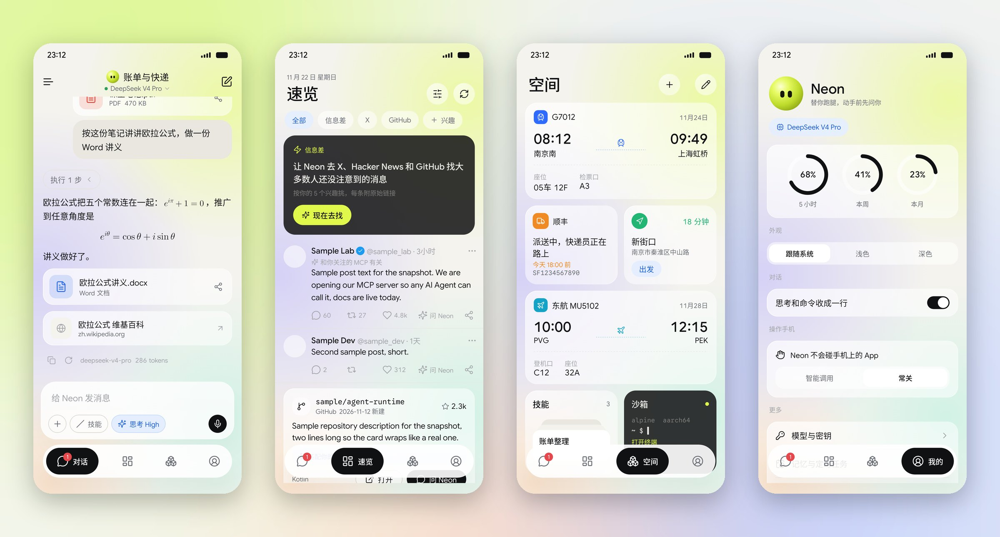
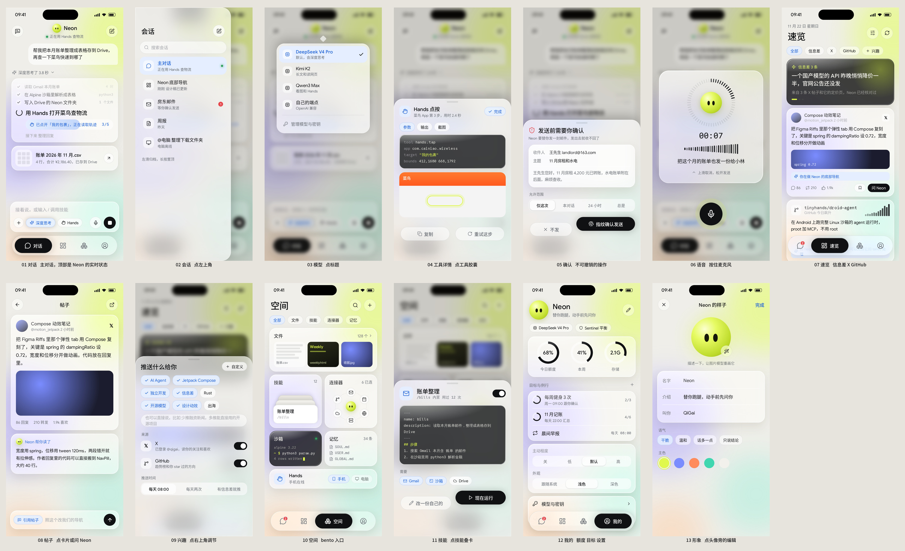

<div align="center">


# Neon

在手机上替你做事的 AI

<a href="https://github.com/QiGai77/neon/releases/latest"></a>


[下载 APK](https://github.com/QiGai77/neon/releases/latest) &nbsp;&nbsp; [网页版](https://neon.qigai.tech) &nbsp;&nbsp; [设计规范](docs/design/v0.4/DESIGN.md) &nbsp;&nbsp; [更新记录](https://github.com/QiGai77/neon/releases)

<br />

<picture>
  <source media="(prefers-color-scheme: dark)" srcset="docs/hero-dark.jpg" />
  
</picture>

</div>

<br />

## 四个页面

<table>
<tr>
<td width="50%" valign="top">

### 对话

DeepSeek 官方 API 和 OpenCode Go 订阅，深度思考，流式输出。每一步做了什么都摊开给你看，也能一键折叠。对话存在本机，连上 Google Drive 后自动备份。

</td>
<td width="50%" valign="top">

### 速览

按你的兴趣推送最近两周值得看的 GitHub 新项目，每张卡片写明为什么推给你。一键让 Neon 去 X、Hacker News 和 GitHub 找大多数人还没注意到的消息。

</td>
</tr>
<tr>
<td width="50%" valign="top">

### 空间

技能、连接器、沙箱、记忆、定时任务、Hands 和 Drive 都在这一页。技能市场和连接器市场可以直接安装。

</td>
<td width="50%" valign="top">

### 我的

额度用量、外观、默认深度思考、Hands 开关、模型和密钥，都在这里调。

</td>
</tr>
</table>

## 能做什么

**Linux 沙箱**
内置 Alpine Linux，带 Python 和常用开发工具，不联网也能跑。Neon 可以在里面写脚本、处理表格、跑程序。删除文件这类命令会先停下来问你。

**Hands**
让 Neon 直接操作手机上的应用，比如打开菜鸟查快递。支持无障碍和 Shizuku 两种方式。遇到付款、发送、删除，先指纹确认；遇到密码框，交给你自己输入。

**连接器**
内置 35 个常用服务。Google 登录一次就能读写 Gmail、日历和 Drive，对话也顺带备份到 Drive，只需要在 Google Cloud 建一个自己的桌面应用客户端。速览里的 X 帖子不用登录，加上想看的账号就行。远程 MCP 服务器自动走 OAuth 授权，也可以在沙箱里跑本地 MCP。Webhook 可以接 Tasker 等自动化工具。

**技能**
技能是一个 SKILL.md 文件，自带 12 个，也能从技能市场安装。对话里输入 `/` 调用。Hands 跑完一次任务，可以把过程存成技能，下次直接用。

**记忆和定时任务**
Neon 会记住你告诉它的事，每次对话前带上。定时任务按时在后台运行，跑完发通知。

<br />

## 设计

v0.4 换成了液态玻璃：浮动的磨砂导航，半透明卡片，背后是柔和的色场。颜色、模糊、圆角、间距、动效参数和每个交互的说明都在 [DESIGN.md](docs/design/v0.4/DESIGN.md)，26 张设计稿在 [screens](docs/design/v0.4/screens)。

<picture>
  <source media="(prefers-color-scheme: dark)" srcset="docs/design/v0.4/flow-dark.jpg" />
  
</picture>

## 安装

1. 在 [Releases](https://github.com/QiGai77/neon/releases/latest) 下载最新的 `neon-v*.apk`
2. 允许安装未知来源应用
3. 打开后连接 DeepSeek 或导入 OpenCode Go 的 Key

从 v0.3.1 起可以直接覆盖升级。装过 v0.2 或 v0.3.0 的话，签名不同，需要先卸载旧版。

要用 Hands，到系统设置里开启 Neon 的无障碍服务，或者安装 Shizuku。

## 隐私

Neon 没有自己的服务器。API Key 加密存在本机 Keystore。Google 授权只申请邮件、日历和 Drive 需要的范围，Drive 里只能改 Neon 自己创建的文件，其他文件只读。

## 构建

```bash
cd android
python3 scripts/prepare-offline-sandbox.py   # 下载 Alpine 和 PRoot
gradle :app:assembleDebug
```

沙箱里要带 Python，用 `scripts/build-offline-rootfs.sh` 构建 rootfs，需要 Docker。

推送 `v*` 标签时，GitHub Actions 会构建签名 APK 并上传到对应的 Release。

## 网页版

网页版代码在仓库根目录，`pnpm install && pnpm dev` 启动，需要 Node.js 22.12 以上。

<br />

<div align="center">

<br />
<sub>MIT License</sub>
</div>
