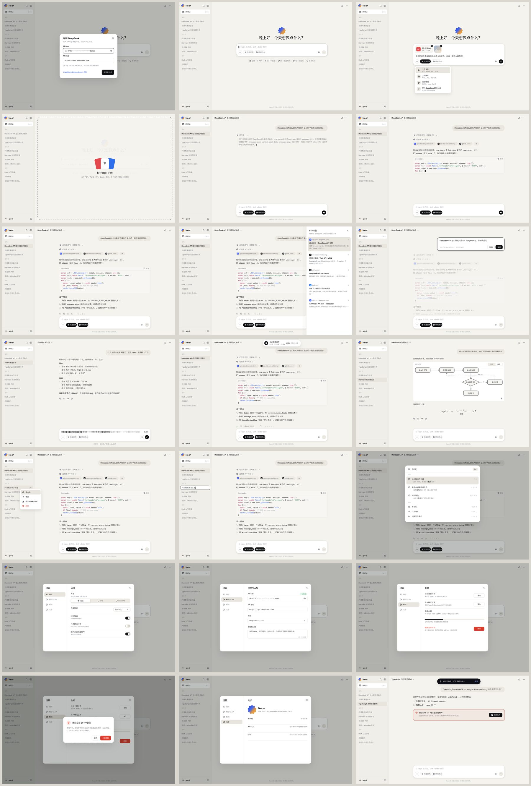
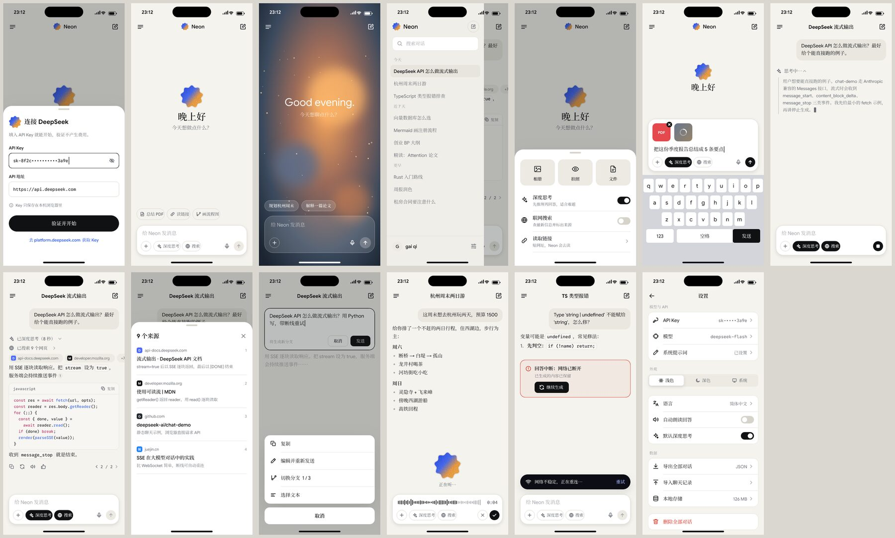
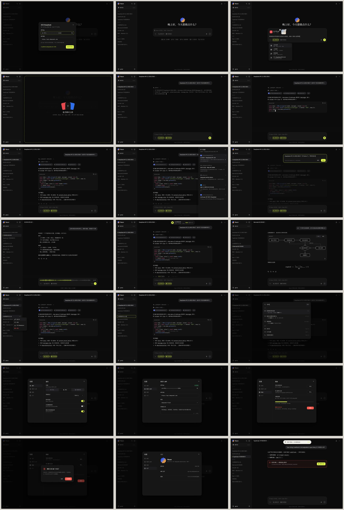

<div align="center">


# Neon

**一个安静、好看的 AI 对话客户端**

浏览器打开就能用 · 对话存进你自己的 Google Drive · 支持 OpenCode Go 订阅

[**在线使用 →**](https://neon.qigai.tech) &nbsp;·&nbsp; [**下载安卓 APK**](https://github.com/QiGai77/neon/releases/latest) &nbsp;·&nbsp; [设计稿](design/)

<br />



</div>

<br />

## ✦ 亮点

|  |  |
| --- | --- |
| 🎨 **克制的设计** | 浅色暖米白、深色纯黑 + 一抹青柠绿。英文 Google Sans，中文思源黑体细体，代码 Google Sans Code。 |
| 🗂 **Google Drive 工作区** | 对话自动同步到 `我的云端硬盘/Neon`，从 Drive 选文件当附件，上传的文件也存一份回去，一键整库备份。 |
| ⚡ **OpenCode Go 订阅** | 粘贴 Go 的 API Key 或直接导入 `auth.json`，侧边栏实时显示 5 小时 / 每周 / 每月剩余额度，几十个模型随便切。 |
| 🧠 **完整的对话能力** | 多会话、分支、深度思考、联网搜索与引用、读链接、附件、语音输入与朗读、Markdown / KaTeX / Mermaid。 |
| 📱 **手机也好用** | 响应式布局，安卓 APK 基于 Chrome 内核全屏运行，Google 登录正常可用。 |
| 🔒 **数据在你手里** | 没有自己的后端。API Key 只存在本机浏览器，Drive 只申请 `drive.file` 权限。 |

<br />

<div align="center">

</div>

<br />

## ✦ 开始使用

**最快的方式**：打开 [neon.qigai.tech](https://neon.qigai.tech)，填 DeepSeek API Key，或在侧边栏「OpenCode Go」里导入订阅。

**安卓**：到 [Releases](https://github.com/QiGai77/neon/releases/latest) 下载 `neon-*.apk` 安装（需要允许「安装未知来源应用」，手机上要有 Chrome）。

**自己部署**：

```bash
pnpm install
pnpm dev          # http://localhost:8090
pnpm build        # 产物在 dist/，放到任意静态托管即可
```

需要 Node.js 22.12+ 和 pnpm。

<br />

## ✦ OpenCode Go

[OpenCode Go](https://opencode.ai/docs/console/go) 是 OpenCode 的模型订阅（$10/月起），一个 Key 可以用 DeepSeek、Kimi、GLM、Qwen、MiniMax 等几十个模型。

1. 在 [opencode.ai/console](https://opencode.ai/console) 订阅 Go，复制 API Key。
2. Neon 侧边栏 →「OpenCode Go」→ 粘贴 Key，或选择本机 OpenCode 的 `auth.json`（`~/.local/share/opencode/auth.json`）。
3. 选模型，开始聊。额度面板每分钟自动刷新，显示 5 小时、本周、本月三个窗口的剩余百分比和重置时间。

> opencode.ai 的推理接口不支持浏览器跨域，Neon 通过自己的 Cloudflare Worker 转发（`/api/opencode/*`，只放行 Go 的推理和额度接口，不记录内容）。自建时可用 `NEON_PROXY` 指向你自己的转发地址。
>
> Go 模式下暂不支持附件和联网搜索；深度思考取决于所选模型。

<br />

## ✦ Google Drive 工作区

```
我的云端硬盘/Neon/
├── 对话/   每个对话一个 JSON，变化 4 秒后自动同步；本地删除的对话移到 Drive 回收站
├── 附件/   聊天里上传的文件副本（可关闭）
└── 备份/   完整历史 ZIP，在「设置 → 数据管理 → 导入」即可恢复
```

<details>
<summary><b>自建时配置自己的 Google OAuth 客户端</b></summary>

<br />

1. [Google Cloud Console](https://console.cloud.google.com/) 新建项目，启用 **Google Drive API**（要用文件选择器再启用 **Google Picker API**）。
2. 「Google Auth Platform」：受众选「外部」，范围加 `.../auth/drive.file`，测试用户加上你的账号。
3. 创建「Web 应用」类型的 OAuth 客户端，授权的 JavaScript 来源填你的访问地址（如 `http://localhost:8090`）。
4. 构建时写入：

```bash
# API Key 和项目编号是可选的，只有文件选择器需要
NEON_GOOGLE_CLIENT_ID=xxx.apps.googleusercontent.com \
NEON_GOOGLE_API_KEY=AIza... \
NEON_GOOGLE_APP_ID=123456789012 \
pnpm build
```

也可以不写死，在 Neon「工作区 → Google Cloud 配置」里填。

</details>

- 访问令牌只在内存里，刷新页面后点一下「重新授权」即可。
- 同步是单向的（本机 → Drive），换设备时用备份 ZIP 导入。

<br />

## ✦ 安卓 APK

`android/` 是一个最小的 [Trusted Web Activity](https://developer.chrome.com/docs/android/trusted-web-activity) 壳：用 Chrome 内核全屏打开 neon.qigai.tech，网页更新后 App 自动是最新版。推一个 `v*` 标签，GitHub Actions 会自动编译并挂到 Release。

<br />

<div align="center">

</div>

<br />

## ✦ 致谢

- 基于 [deepseek-ai/chat-demo](https://github.com/deepseek-ai/chat-demo)（MIT），原版说明见 [README.chat-demo.md](README.chat-demo.md)。
- 字体：Google Sans、Noto Sans SC、Google Sans Code。

<sub>MIT License</sub>
