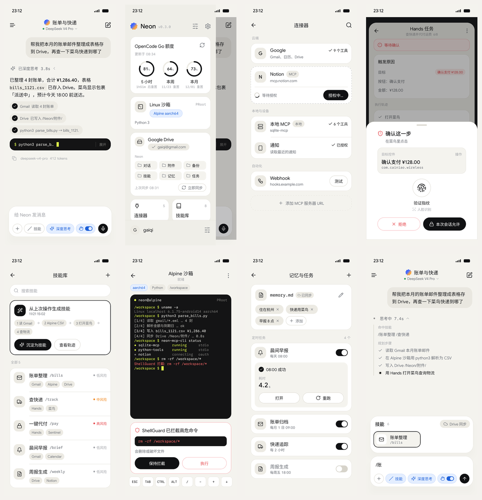
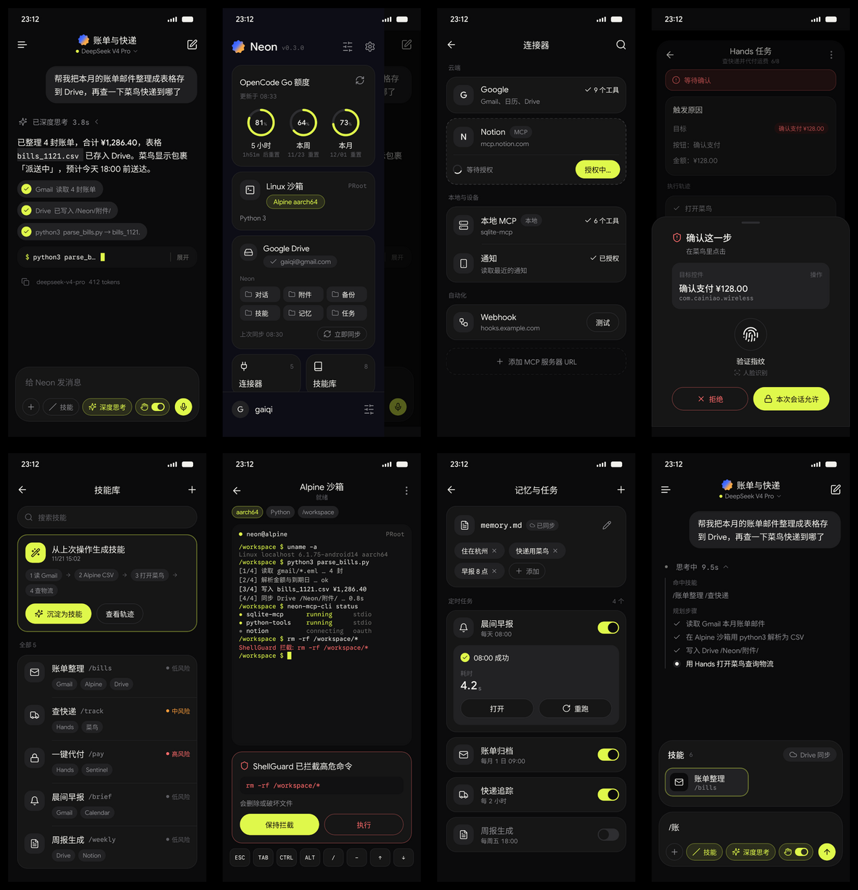

<div align="center">


# Neon

在手机上替你做事的 AI

[下载 APK](https://github.com/QiGai77/neon/releases/latest) &nbsp;&nbsp; [网页版](https://neon.qigai.tech) &nbsp;&nbsp; [更新记录](https://github.com/QiGai77/neon/releases)

<br />



</div>

<br />

## 能做什么

**对话**
DeepSeek 官方 API 和 OpenCode Go 订阅，深度思考，流式输出。对话存在本机，连上 Google Drive 后自动备份。

**Linux 沙箱**
内置 Alpine Linux，不联网也能跑。Neon 可以在里面写脚本、处理表格、跑 Python。删除文件这类命令会先停下来问你。

**Hands**
让 Neon 直接操作手机上的应用，比如打开菜鸟查快递。支持无障碍和 Shizuku 两种方式。遇到付款、发送、删除，先指纹确认；遇到密码框，交给你自己输入。

**连接器**
Gmail、Google 日历、Google Drive。远程 MCP 服务器自动走 OAuth 授权，也可以在沙箱里跑本地 MCP。Webhook 可以接 Tasker 等自动化工具。

**技能**
技能是一个 SKILL.md 文件。对话里输入 `/` 调用。Hands 跑完一次任务，可以把过程存成技能，下次直接用。

**记忆和定时任务**
Neon 会记住你告诉它的事，每次对话前带上。定时任务按时在后台运行，跑完发通知。

<br />

<div align="center">

</div>

<br />

## 安装

1. 在 [Releases](https://github.com/QiGai77/neon/releases/latest) 下载 `neon-v0.3.1.apk`
2. 允许安装未知来源应用
3. 打开后连接 DeepSeek 或导入 OpenCode Go 的 Key

装过 v0.2 或 v0.3.0 的话，签名不同，需要先卸载旧版。

要用 Hands，到系统设置里开启 Neon 的无障碍服务，或者安装 Shizuku。

## 隐私

Neon 没有自己的服务器。API Key 加密存在本机 Keystore。Google 授权只申请需要的范围，Drive 只能看到 Neon 自己创建的文件。

## 构建

```bash
cd android
python3 scripts/prepare-offline-sandbox.py   # 下载 Alpine 和 PRoot
gradle :app:assembleDebug
```

沙箱里要带 Python，用 `scripts/build-offline-rootfs.sh` 构建 rootfs，需要 Docker。

推送 `v*` 标签时，GitHub Actions 会构建签名 APK 并上传到对应的 Release。

## 网页版

网页版代码在仓库根目录，`pnpm install && pnpm dev` 启动，需要 Node.js 22.12 以上。

<br />

<div align="center">
<sub>MIT License</sub>
</div>
