# v0.4.5 改版交接：我的、性格、关于你、动手前、对话样式

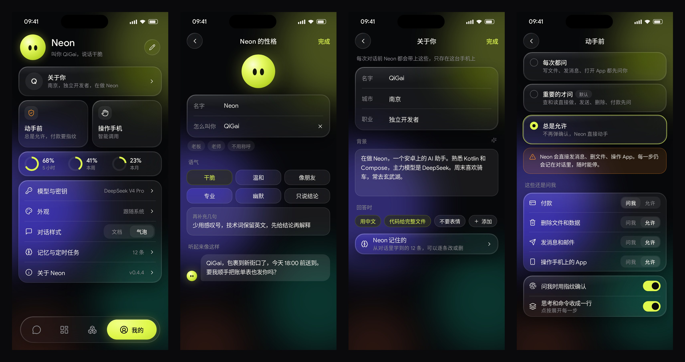
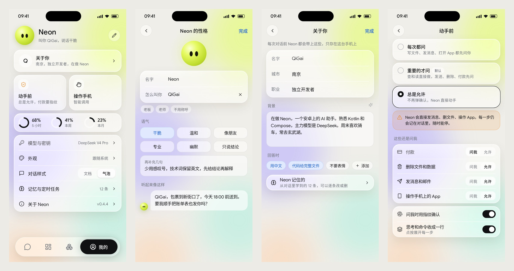
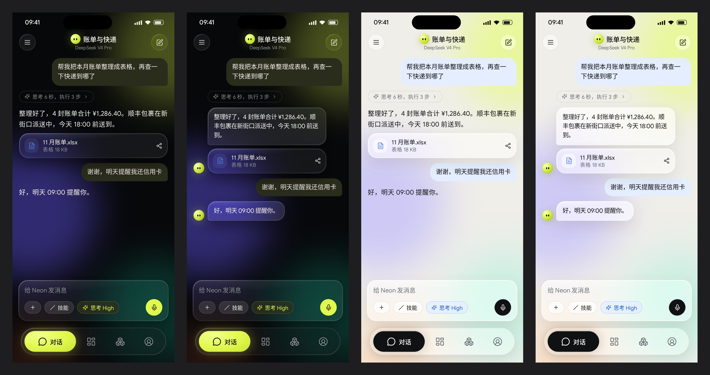

给接手的 AI。设计稿在 `screens/`（深浅色各一张），总览 `board-dark.jpg`、`board-light.jpg`、`board-chat.jpg`。生成脚本 `gen_me.py`（依赖 `docs/design` 外的 v036 gen.py，仅供参考，以 PNG 为准）。视觉参数沿用 `../v0.4/DESIGN.md`。文案规则：不用「A · B · C」，不加括号补充，不用斜杠列举。

## 1. 我的 `01-me`

| 深色 | 浅色 |
|---|---|
| 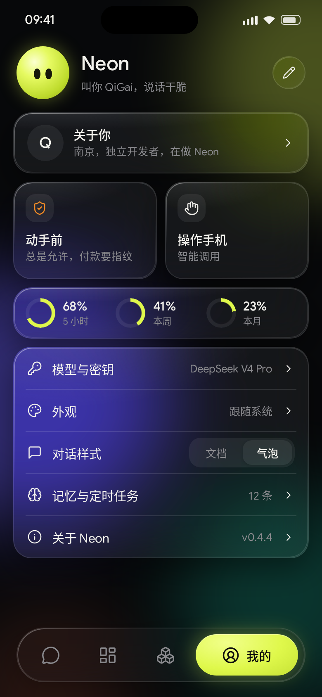 | 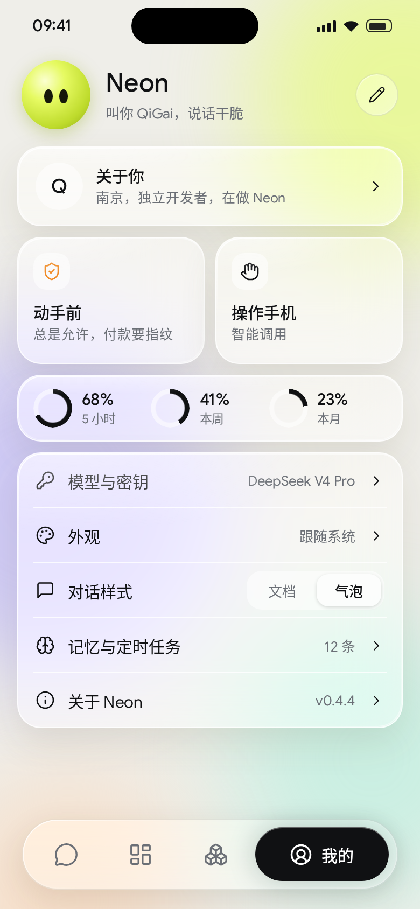 |
文件：`ui/me/Me.kt`（`MeContent` 保持无状态，方便快照）。
- 头部：NeonOrb 64dp，名字，下方一行由性格设置拼出：`叫你 {称呼}，说话{语气}`。右侧铅笔进入「Neon 的性格」。
- 「关于你」卡：首字母头像，标题，副标题取背景前 20 字，进入「关于你」。
- 两张半宽卡：「动手前」显示当前档位（如「总是允许，付款要指纹」），「操作手机」显示智能调用或常关。点开各自页面。
- 额度：一行三个小环（36dp），替换原来的大环卡。
- 列表：模型与密钥、外观、对话样式（行内 Segmented：文档、气泡，直接切换，不进二级页）、记忆与定时任务、关于 Neon（版本号，进入关于页：版本、GitHub、许可证、检查更新）。
- 原「思考和命令收成一行」开关移到动手前页。

## 2. Neon 的性格 `02-persona`

| 深色 | 浅色 |
|---|---|
| 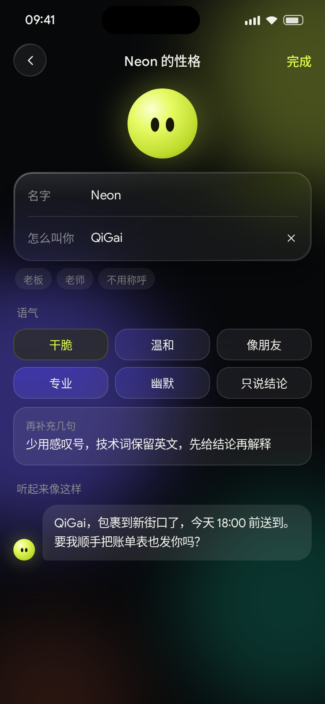 | 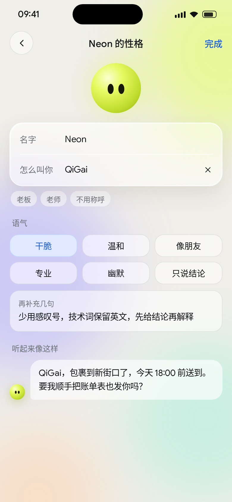 |
新文件 `ui/me/Persona.kt`。设置键（`SettingsRepository`）：
- `agent_name`（默认 Neon），`user_call`（怎么叫你，空表示不用称呼；快捷 chip：老板、老师、不用称呼）
- `tone`：crisp 干脆 | gentle 温和 | friend 像朋友 | pro 专业 | witty 幽默 | brief 只说结论（默认 crisp）
- `tone_extra`：自由补充，多行
- 底部「听起来像这样」：用本地模板按语气拼一句示例，不调模型。
- 接入：`AgentRuntime` 的 SYSTEM 末尾追加「你叫{name}。称呼用户为{call}。语气：{tone 说明}。{tone_extra}」。

## 3. 关于你 `03-about`

| 深色 | 浅色 |
|---|---|
| 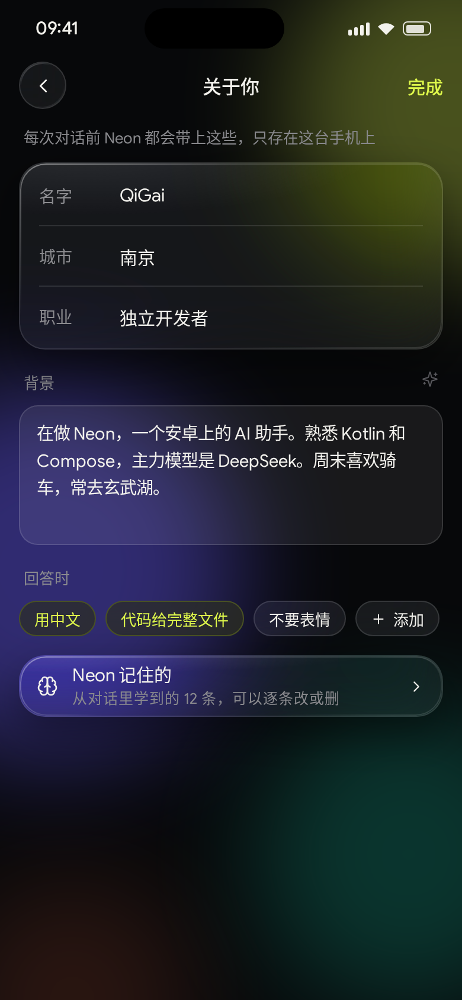 | 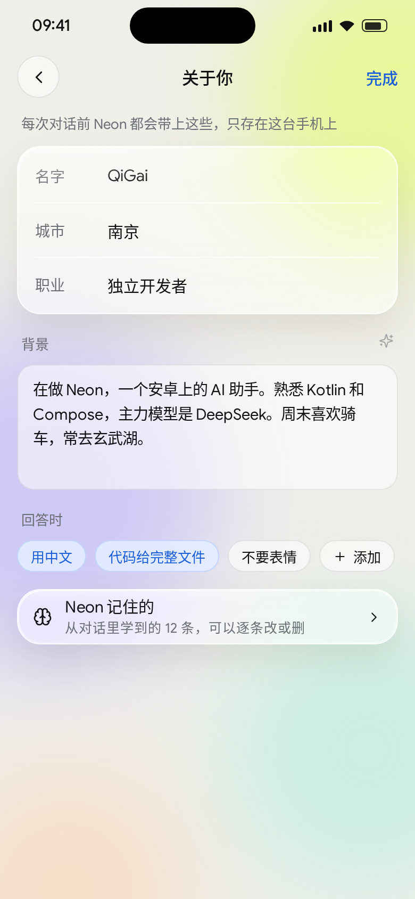 |
新文件 `ui/me/AboutYou.kt`。设置键：`user_name`、`user_city`、`user_job`、`user_bio`（多行背景）、`answer_prefs`（JSON 数组，如 用中文、代码给完整文件、不要表情，可添加）。
- 顶部说明：每次对话前 Neon 都会带上这些，只存在这台手机上。
- 「Neon 记住的」进入现有记忆页（MemoryTasksRoute）。
- 接入：SYSTEM 里加一段「关于用户」。空字段不写。

## 4. 动手前 `04-perms`

| 深色 | 浅色 |
|---|---|
| 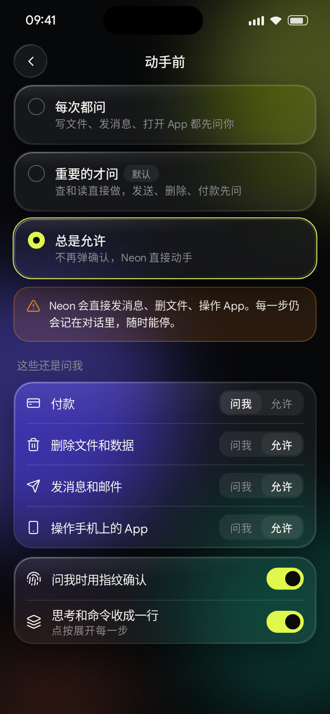 | 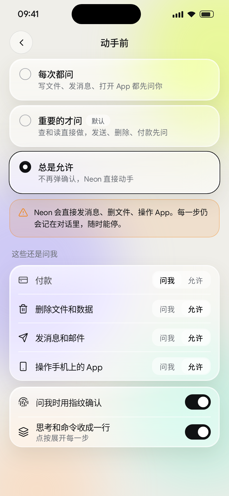 |
新文件 `ui/me/Permissions.kt`；策略在 `guard/RiskPolicy.kt`。
- 设置键 `approval_mode`：always_ask 每次都问 | important 重要的才问（默认，对应现有行为）| always_allow 总是允许。
- 选总是允许时显示橙色提示卡（文案见稿）。
- 「这些还是问我」按类型覆盖，键 `approval_overrides` JSON：`{payment, delete, send, hands}` → ask | allow。默认 payment=ask，其余随档位。
- 映射：工具的风险等级（CONFIRM 等）先查类型覆盖，再按档位决定是否弹 Sentinel 确认。always_ask 时写文件、发消息、打开 App 也要确认。
- 卡片底部两个开关：问我时用指纹确认（现有逻辑），思考和命令收成一行（原 `ops_collapsed`，从我的页移过来）。
- 我的页「动手前」小卡副标题根据这些值生成。

## 5. 对话样式 `05-chat-doc` `06-chat-bubble`

| 文档 深色 | 气泡 深色 | 文档 浅色 | 气泡 浅色 |
|---|---|---|---|
| 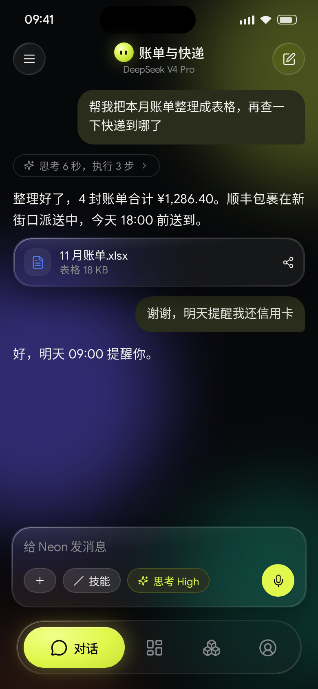 | 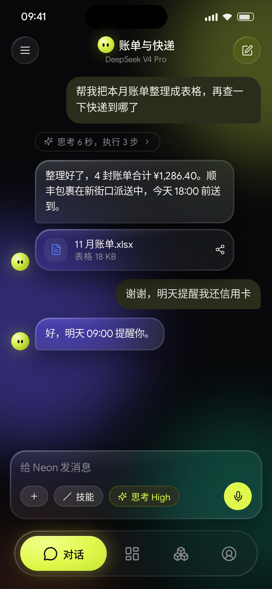 | 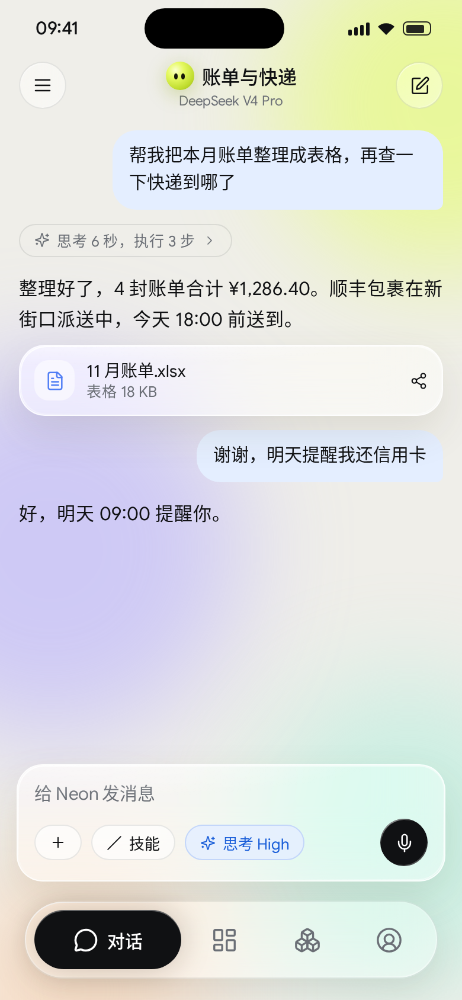 | 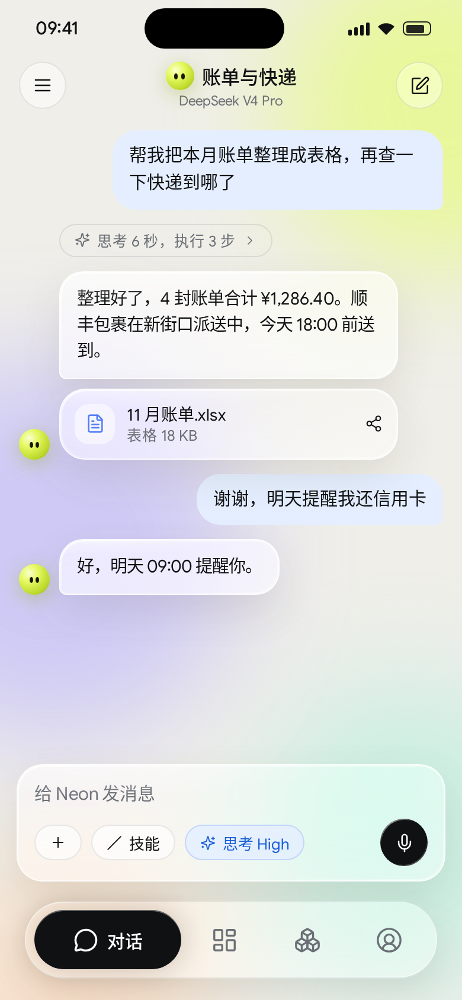 |
文件：`ui/chat/Messages.kt`、`ChatScreen.kt`。
- 设置键 `chat_style`：doc 文档（现状，Neon 回复是正文）| bubble 气泡。
- 气泡：Neon 回复放进左侧玻璃气泡（圆角 20/20/20/6，最大宽 80%），左下角 26dp NeonOrb；文件卡、链接卡紧跟在气泡下方、同样左缩进；折叠胶囊左缩进 34dp。用户气泡不变。
- 公式、代码块在气泡内可横向滚动，不撑破宽度。
- 切换入口只在我的页「对话样式」那一行，对话页不放切换控件。切换后已有消息立即重排，不需要重启。

## 验证
- 给每个新页面加 Roborazzi 测试（深浅色），放进 `ScreensSnapshotTest.kt`，与稿对照。本地 arm64 需临时把 robolectric 换成 4.18.1 并加 nativeruntime-dist-compat 1.0.20，提交前改回 4.14.1。
- `compileDebugKotlin` 通过后再打 tag 发版。

## 改稿
改 `gen_me.py` 后在 /workspace 外也能跑：需要 playwright + chromium，以及 v036 的 gen.py、gen2.py 和 Lucide svg。改完重新导出 screens 和 board，并同步本文件。
